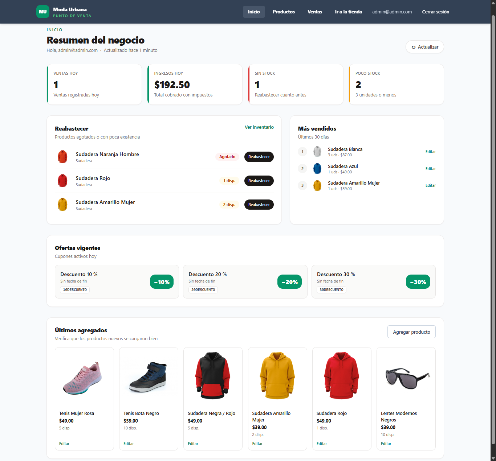
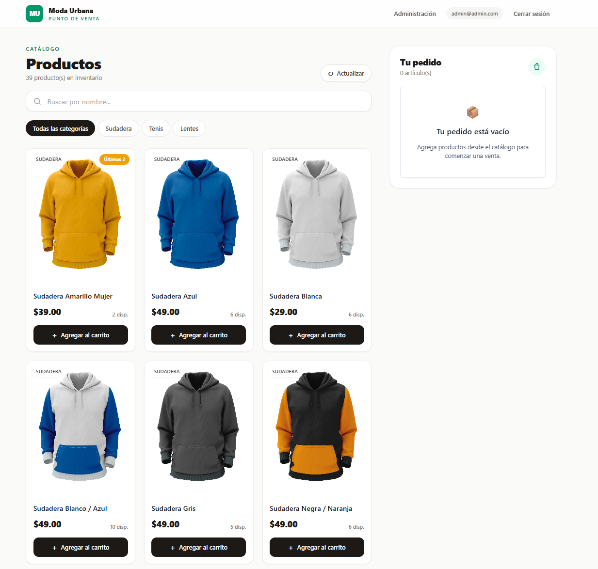

# Moda Urbana · POS

Sistema de punto de venta para una tienda de ropa y accesorios. Incluye una tienda para cobrar, un panel de administración con resumen del negocio, inventario y ventas, y una API que concentra toda la lógica de negocio.





> El navegador **no accede directamente a Firestore**. Toda lectura y escritura pasa por una API Express que valida la sesión de Firebase, aplica las reglas de negocio y registra las ventas dentro de una transacción atómica.

## Características

**Tienda (cobro)**
- Catálogo con búsqueda por nombre (sin distinguir mayúsculas ni acentos), filtro por categoría e indicadores de stock bajo.
- Carrito con control de cantidad, límite por producto y reconciliación automática de stock y precio.
- Cupones validados en el servidor, con el descuento aplicado antes de impuestos.
- Confirmación de venta idempotente: reintentar no duplica la venta.
- En móvil, barra inferior con cantidad y total que lleva al carrito.

**Administración**
- **Inicio:** resumen del día (ventas e ingresos), productos para reabastecer, top 5 de los últimos 30 días, cupones activos y últimos productos agregados.
- **Inventario:** alta, edición y borrado de productos con imagen.
- **Ventas:** consulta de ventas por día con su total.

**Seguridad y robustez**
- Autenticación con Firebase Auth y autorización por roles (`admin`, `cashier`) mediante custom claims.
- Firestore cerrado al cliente; Storage con lectura pública y escritura solo para administradores.
- Validación de entrada con Zod en el servidor y FormKit en el cliente.
- Rate limiting, Helmet, CORS con orígenes explícitos y errores con `requestId`.

**Escalabilidad**
- Pensado para hasta **1 000 productos** y **10 000 ventas al mes**.
- El resumen de ventas se mantiene en `dailySummaries/{fecha}` dentro de la misma transacción del checkout, así el panel nunca escanea todas las ventas.
- Resumen del inicio con caché corta en memoria.

## Stack

| Capa | Tecnología |
| --- | --- |
| Frontend | Vue 3, Vue Router, Pinia, Tailwind CSS, FormKit, Vite |
| Backend | Node.js 22, Express 4, Zod, Pino, Helmet, express-rate-limit |
| Datos | Firebase Auth, Firestore y Storage (Firebase Admin SDK en el servidor) |
| Calidad | ESLint, Vitest, GitHub Actions |

**Requisito: Node.js 22.12 o superior** (Vite 8, Vitest 5 y firebase-admin 14 lo exigen).

## Arquitectura

```text
src/                      Aplicación Vue (presentación)
  api/                    Cliente HTTP y APIs por dominio
  components/             Componentes reutilizables (incluye components/dashboard)
  composables/            Lógica reutilizable (imágenes, moneda)
  layouts/                Layout del panel de administración
  stores/                 Estado Pinia y flujos del cliente
  views/                  Tienda, login e inicio/inventario/ventas del admin
server/                   API Express (lógica de negocio)
  src/routes/             Contrato HTTP
  src/controllers/        Adaptación HTTP <-> servicios
  src/services/           Reglas de negocio
  src/repositories/       Acceso a Firestore
  src/schemas/            Validación Zod
  src/middleware/         Auth, validación, errores, rate limit
  scripts/                Utilidades de administración y migración
shared/                   Constantes y cálculo de totales compartidos
public/products/          Imágenes de producto servidas por el frontend
docs/                     Arquitectura, API y especificaciones
```

Documentación detallada:
- [`docs/ARCHITECTURE.md`](docs/ARCHITECTURE.md): capas, flujo de venta, garantías del checkout y modelo de datos.
- [`docs/API.md`](docs/API.md): endpoints, formato de errores y ejemplos.
- [`docs/LANDING_SPEC.md`](docs/LANDING_SPEC.md): especificación de la pantalla de inicio.

## Instalación

### 1. Clonar e instalar

```bash
git clone https://github.com/FerGMdev/vue-pos-system.git
cd vue-pos-system
npm install
```

`npm install` instala también el workspace del backend (`server/`).

### 2. Crear el proyecto de Firebase

En [Firebase Console](https://console.firebase.google.com/):

1. Crea un proyecto.
2. Habilita **Authentication > Sign-in method > Email/Password**.
3. Crea una base de datos **Firestore**.
4. Registra una **aplicación web** y copia su configuración.
5. Genera una **cuenta de servicio** en *Configuración del proyecto > Cuentas de servicio* (para el backend).

> **Storage y plan de pago:** Firebase Storage requiere el plan Blaze. En el plan gratuito las imágenes de Storage devuelven error 402. El proyecto sirve las imágenes de `public/products/` para que el catálogo funcione sin Blaze. La subida de imágenes desde el panel solo funciona con Blaze habilitado.

### 3. Variables de entorno

Copia los archivos de ejemplo:

```bash
cp .env.example .env
cp server/.env.example server/.env
```

En Windows (PowerShell):

```powershell
Copy-Item .env.example .env
Copy-Item server\.env.example server\.env
```

Completa `.env` con la configuración web de Firebase:

```dotenv
VITE_FIREBASE_API_KEY=...
VITE_FIREBASE_AUTH_DOMAIN=tu-proyecto.firebaseapp.com
VITE_FIREBASE_PROJECT_ID=tu-proyecto
VITE_FIREBASE_STORAGE_BUCKET=tu-proyecto.appspot.com
VITE_FIREBASE_MESSAGING_SENDER_ID=...
VITE_FIREBASE_APP_ID=...
VITE_API_URL=
```

Y `server/.env` con las credenciales del backend:

```dotenv
FIREBASE_PROJECT_ID=tu-proyecto
FIREBASE_STORAGE_BUCKET=tu-proyecto.appspot.com
GOOGLE_APPLICATION_CREDENTIALS=C:\ruta\fuera\del\repo\service-account.json
CORS_ORIGIN=http://localhost:5173
```

> Usa **una** de estas dos opciones para las credenciales: `GOOGLE_APPLICATION_CREDENTIALS` (ruta a un archivo fuera del repositorio, recomendado) o `FIREBASE_SERVICE_ACCOUNT_JSON` (el JSON completo en una sola línea). Nunca subas credenciales al control de versiones.

### 4. Aplicar reglas de seguridad

```bash
npm install -g firebase-tools
firebase login
firebase use --add
firebase deploy --only firestore:rules,storage
```

Las reglas cierran Firestore por completo al cliente y permiten lectura pública de imágenes, con escritura solo para administradores.

### 5. Crear el primer administrador

1. Crea el usuario en **Authentication > Users**.
2. Asígnale el rol:

```bash
npm run set-role -- admin@ejemplo.com admin
```

El usuario debe cerrar sesión y volver a entrar para que el claim se refleje.

### 6. Datos iniciales (opcional)

Para un negocio nuevo, carga un catálogo de ejemplo:

```bash
npm run seed
# Reemplaza los productos existentes:
npm run seed -- --replace
```

Para generar el resumen del inicio a partir de ventas existentes (una sola vez):

```bash
npm run migrate:sales                     # solo si hay ventas con fechas dd/mm/yyyy
npm run backfill:summaries -- --apply     # genera dailySummaries desde las ventas
```

### 7. Ejecutar en desarrollo

```bash
npm run dev:all
```

- Frontend: http://localhost:5173
- API: http://localhost:3000/api
- Health check: http://localhost:3000/api/health

También puedes levantar cada parte por separado con `npm run dev` y `npm run dev:api`.

## Uso

| Ruta | Quién | Qué hace |
| --- | --- | --- |
| `/` | Todos | Tienda: catálogo, carrito y cobro (el cobro pide iniciar sesión) |
| `/login` | Todos | Inicio de sesión |
| `/admin/inicio` | Admin | Resumen del negocio |
| `/admin/productos` | Admin | Inventario |
| `/admin/productos/nuevo` | Admin | Alta de producto |
| `/admin/ventas` | Admin | Ventas por día |

Los cupones disponibles se configuran en `server/src/config/coupons.js`. Puedes añadir `name`, `startsAt` y `endsAt` (YYYY-MM-DD) para que aparezcan como ofertas con vigencia en el inicio.

## Scripts

| Comando | Descripción |
| --- | --- |
| `npm run dev` | Servidor de desarrollo del frontend |
| `npm run dev:api` | API con recarga automática |
| `npm run dev:all` | Frontend + API en paralelo |
| `npm run build` | Build de producción del frontend |
| `npm run preview` | Sirve el build localmente |
| `npm run lint` | ESLint sobre todo el repositorio |
| `npm test` | Tests de Vitest (frontend compartido + backend) |
| `npm run seed` | Carga el catálogo de ejemplo (`-- --replace` para reemplazar) |
| `npm run set-role -- <email> <admin\|cashier>` | Asigna rol a un usuario |
| `npm run migrate:sales` | Normaliza ventas antiguas a `createdAt` ISO + `dateKey` |
| `npm run backfill:summaries -- --apply` | Genera los resúmenes diarios desde las ventas existentes |
| `npm run migrate:images -- --apply` | Reemplaza URLs de Storage por imágenes locales de `public/products` |

`backfill:summaries` y `migrate:images` simulan por defecto y solo escriben con `--apply`. `migrate:sales` escribe directamente, así que ejecútalo una sola vez.

## Roles y permisos

| Acción | Público | `cashier` | `admin` |
| --- | --- | --- | --- |
| Ver catálogo y validar cupones | Sí | Sí | Sí |
| Confirmar una venta | No | Sí | Sí |
| Ver el inicio, inventario y ventas | No | No | Sí |
| Gestionar productos | No | No | Sí |

El rol vive en un **custom claim** de Firebase (`role: "admin" | "cashier"`). El backend lo verifica en cada request; el frontend solo lo usa para mostrar u ocultar rutas.

## Reglas de negocio

- **Impuestos:** `TAX_RATE` (por defecto `0.1`) se aplica sobre la base después del descuento.
- **Descuento:** se aplica al subtotal, antes de impuestos.
- **Redondeo:** todos los importes se redondean a centavos con la misma función (`shared/pricing.js`).
- **Límite por producto:** `MAX_ITEM_QUANTITY` (por defecto `5`).
- **Stock:** se valida en el carrito y de nuevo dentro de la transacción. Si cambió, el checkout falla con `INSUFFICIENT_STOCK` y el carrito se reconcilia.
- **Precio:** si el precio cambió, el checkout falla con `PRICE_CHANGED` en lugar de cobrar un importe distinto al mostrado.
- **Idempotencia:** el cliente genera un `checkoutId` UUID. Reintentar la misma venta devuelve la venta existente.
- **Stock bajo:** productos con 3 unidades o menos (`LOW_STOCK_THRESHOLD` en `shared/constants.js`).
- **Fechas:** las ventas guardan `createdAt` en ISO y `dateKey` (`YYYY-MM-DD`) según `TIMEZONE`.

## Variables de entorno

### Frontend (`.env`)

| Variable | Obligatoria | Descripción |
| --- | --- | --- |
| `VITE_FIREBASE_API_KEY` | Sí | API key de la app web |
| `VITE_FIREBASE_AUTH_DOMAIN` | Sí | Dominio de Auth |
| `VITE_FIREBASE_PROJECT_ID` | Sí | ID del proyecto |
| `VITE_FIREBASE_STORAGE_BUCKET` | Sí | Bucket de Storage |
| `VITE_FIREBASE_MESSAGING_SENDER_ID` | Sí | Sender ID |
| `VITE_FIREBASE_APP_ID` | Sí | App ID |
| `VITE_API_URL` | No | URL base de la API (por defecto `/api` con el proxy de Vite) |
| `VITE_API_TIMEOUT_MS` | No | Timeout de requests (por defecto `15000`) |
| `VITE_USE_FIREBASE_EMULATORS` | No | `true` para usar Auth y Storage locales |
| `VITE_FIREBASE_AUTH_EMULATOR_URL` | No | URL del emulador de Auth |
| `VITE_FIREBASE_STORAGE_EMULATOR_HOST` | No | Host del emulador de Storage |

### Backend (`server/.env`)

| Variable | Obligatoria | Descripción |
| --- | --- | --- |
| `PORT` | No | Puerto de la API (por defecto `3000`) |
| `CORS_ORIGIN` | No | Orígenes permitidos, separados por coma |
| `TRUST_PROXY` | No | `true` detrás de un proxy confiable |
| `FIREBASE_PROJECT_ID` | Sí | ID del proyecto |
| `FIREBASE_STORAGE_BUCKET` | No | Bucket; se deduce del project ID |
| `FIREBASE_SERVICE_ACCOUNT_JSON` | Sí* | Credenciales en una línea |
| `GOOGLE_APPLICATION_CREDENTIALS` | Sí* | Alternativa: ruta al JSON |
| `TAX_RATE` | No | Tasa de impuesto (`0.1` = 10 %) |
| `MAX_ITEM_QUANTITY` | No | Máximo por producto |
| `TIMEZONE` | No | Zona horaria para `dateKey` |
| `LOG_LEVEL` | No | Nivel de Pino |
| `RATE_LIMIT_WINDOW_MS` | No | Ventana del rate limit general |
| `RATE_LIMIT_MAX` | No | Requests por ventana |
| `CHECKOUT_RATE_LIMIT_MAX` | No | Checkouts por ventana |
| `DASHBOARD_CACHE_TTL_MS` | No | Caché del resumen del inicio (por defecto `60000`) |

\* Obligatoria salvo que se usen los emuladores.

## Emuladores de Firebase

Útil para desarrollo sin credenciales reales. Requiere Java.

```bash
firebase emulators:start --only auth,firestore,storage
```

Configura `VITE_FIREBASE_PROJECT_ID=demo-pos`, `VITE_USE_FIREBASE_EMULATORS=true` y, en `server/.env`:

```dotenv
FIRESTORE_EMULATOR_HOST=127.0.0.1:8080
FIREBASE_AUTH_EMULATOR_HOST=127.0.0.1:9099
FIREBASE_STORAGE_EMULATOR_HOST=127.0.0.1:9199
```

Con esas variables el backend no exige cuenta de servicio. Los usuarios de prueba se crean en la UI del emulador (http://localhost:4000).

## Despliegue

- **Frontend:** build estático (`dist/`). El `vercel.json` incluido reescribe las rutas al `index.html` para la SPA. Define `VITE_API_URL` con la URL pública de la API.
- **Backend:** servicio Node (`npm start --workspace @pos/server`). Define `CORS_ORIGIN` con el dominio del frontend y `TRUST_PROXY=true` si corre detrás de un proxy.
- **Firebase:** despliega las reglas y mantén la cuenta de servicio fuera del repositorio.
- **Imágenes:** las del catálogo viven en `public/products/` y se despliegan con el frontend.

## Calidad

```bash
npm run lint
npm test
npm run build
```

El workflow de CI (`.github/workflows/ci.yml`) ejecuta lint, tests y build en cada push a `main` y en cada pull request, con Node 22.

## Seguridad y alcance

Este proyecto implementa autenticación real, autorización por roles, validación en el servidor, rate limiting, cabeceras de seguridad y checkout transaccional. Aun así, es un POS de una sola tienda y no incluye:

- Pasarela de pagos ni cobro con tarjeta.
- Recibos ni facturación fiscal.
- Multitienda ni multimoneda.
- Auditoría detallada de movimientos de inventario.
- Recuperación de contraseña desde la interfaz.
- Ajuste rápido de stock desde el inicio.
- Creación y edición de ofertas desde la interfaz (hoy se configuran en el servidor).

Estos puntos están listados como próximos pasos en [`docs/ARCHITECTURE.md`](docs/ARCHITECTURE.md).
